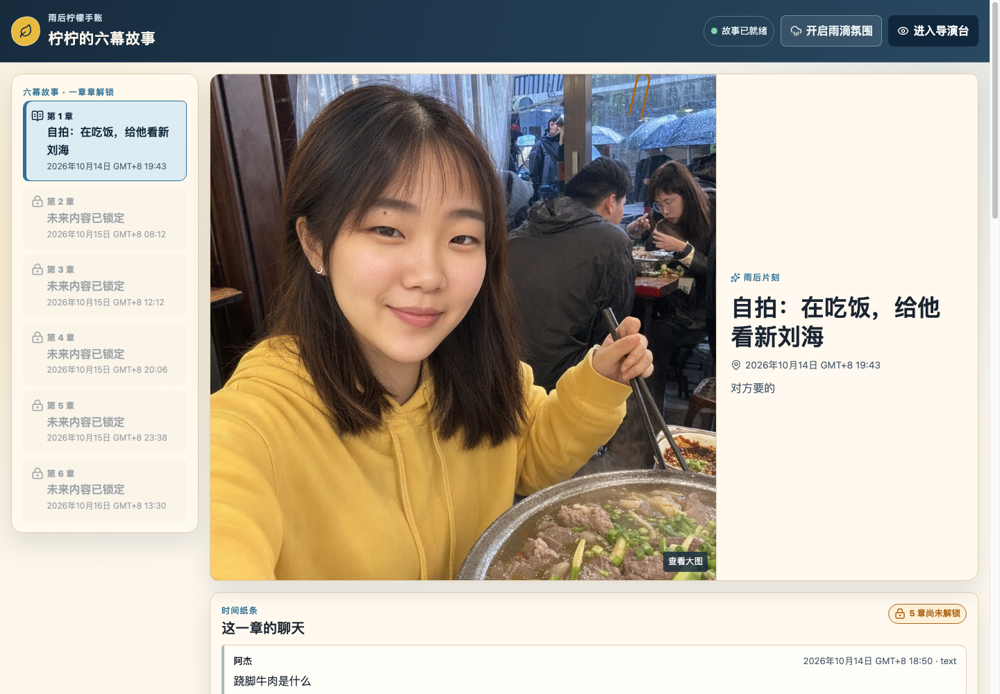
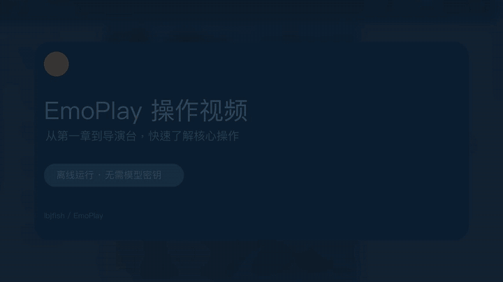
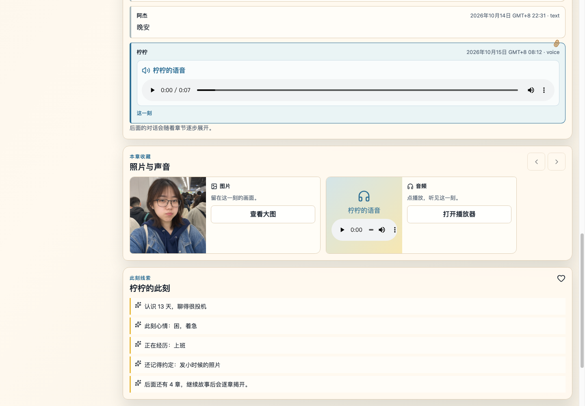
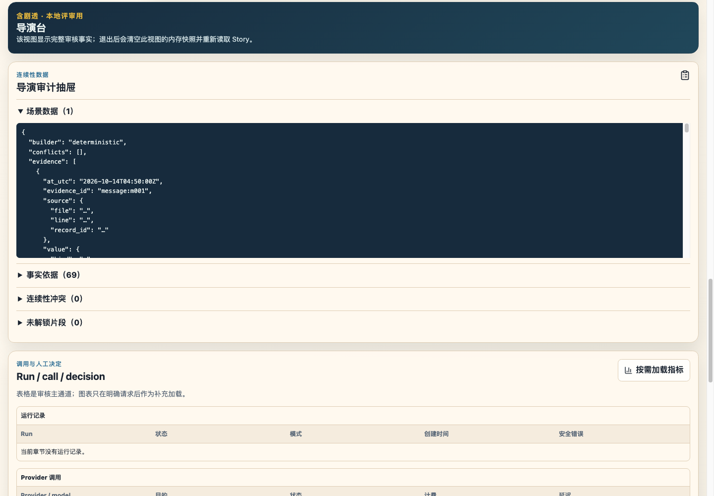
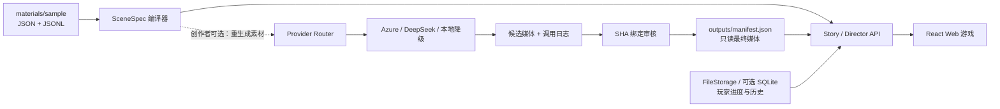

# EmoPlay

一个离线优先、逐章推进的六章互动剧情 Web 应用。玩家通过章节、聊天、图片和语音体验故事；创作者可以进入独立“导演台”查看连续性数据、模型调用、媒体来源与版本历史。

本仓库由 `lbjfish` 维护。默认运行不需要 API Key、Node.js、SQLite 或外网；仓库已包含构建后的前端和经过哈希校验的最终媒体。



## 操作视频

[](docs/assets/emoplay-guide.mp4)

点击动画可打开高清 MP4。视频依次展示离线启动、T1 初始章节、图片与语音、移动端、
导演台以及本地进度重置；全程使用字幕，无需音频。

## 功能概览

- 六章剧情逐步解锁，已解锁章节可随时回看，不会错误回锁。
- 图片消息展示真实图片；T2/T5 语音使用浏览器可播放的 WAV。
- 每章都有独立背景图，真人风格角色在章节间保持连续。
- 解锁下一章时自动保存进度，玩家无需管理书签或剧情分支。
- Story 玩家视图与 Director 导演台严格分离。
- 无 SQLite 模式完整可用；SQLite 只是可选后端。
- 玩家运行完全不需要模型、密钥或联网。
- Azure、DeepSeek 和 macOS 本地语音仅保留给创作者重新生成候选素材。
- 模型调用、延迟、成本估算、媒体 SHA-256、接受/拒绝决定均有日志。
- 真实 Chrome E2E 覆盖桌面、手机、音频播放、章节回看和 Director 布局。

语音与导演台预览：

| 语音章节 | 导演台 |
|---|---|
|  |  |

## 1 分钟快速启动

### macOS / Linux

```bash
git clone https://github.com/lbjfish/EmoPlay.git
cd EmoPlay

python3 -m venv .venv
source .venv/bin/activate
python -m pip install -e .

emoplay serve \
  --config config.offline.toml \
  --materials materials/sample \
  --port 0
```

终端会输出类似：

```json
{"status":"ready","url":"http://127.0.0.1:xxxxx/"}
```

在浏览器打开该 URL 即可。`--port 0` 会自动选择空闲端口，最省心。

### Windows PowerShell

```powershell
git clone https://github.com/lbjfish/EmoPlay.git
Set-Location EmoPlay

py -3.11 -m venv .venv
.\.venv\Scripts\Activate.ps1
python -m pip install -e .

emoplay serve `
  --config config.offline.toml `
  --materials materials/sample `
  --port 0
```

如果 PowerShell 阻止激活脚本，可以不激活环境，直接运行：

```powershell
.\.venv\Scripts\python.exe -m pip install -e .
.\.venv\Scripts\python.exe -m nining serve --config config.offline.toml --materials materials/sample --port 0
```

> `emoplay` 是推荐命令；为兼容历史脚本，`nining` 命令仍然保留。

## 初始化或重置本地存档

FileStorage 只允许一个写进程；执行以下任一 `init` 命令前必须停止正在运行的 EmoPlay 服务。

首次执行 `serve` 会自动创建存档。显式创建一个新的 T1 存档且保留已有进度：

```bash
emoplay init --config config.offline.toml --materials materials/sample
```

彻底清空该配置对应的本地 FileStorage 后重新初始化：

```bash
emoplay init \
  --config config.offline.toml \
  --materials materials/sample \
  --reset
```

命令输出包含新的 `playthrough_id`。指定该 ID 启动可避免恢复其它存档：

```bash
emoplay serve \
  --config config.offline.toml \
  --materials materials/sample \
  --playthrough <playthrough_id> \
  --port 0
```

`--reset` 仅支持带有效格式标记的 FileStorage，并会在存档仍被服务占用或目录含未知文件
时拒绝执行。它不会删除 `outputs/` 中的最终图片、音频或 manifest。

## 运行环境与依赖

| 项目 | 最低/固定版本 | 是否运行必需 | 用途 |
|---|---|---:|---|
| Python | 3.11+ | 是 | 后端、CLI、本地 HTTP 服务、文件存档 |
| 现代浏览器 | Chrome / Edge / Safari / Firefox | 是 | 运行 Story/Director 页面 |
| Node.js | 24（见 `frontend/.nvmrc`） | 否 | 仅修改或重建 React 前端 |
| pnpm | 11.25.0 | 否 | 仅前端开发，版本锁定在 `package.json` |
| SQLite | Python 自带 `sqlite3` | 否 | 可选存储后端；默认 FileStorage 不使用它 |
| macOS `say` | 系统自带 | 否 | 仅重新生成本地预置语音 |
| Azure / DeepSeek | 可选 | 否 | 仅重新生成文本或图片时需要 |

### Python 依赖文件

- `pyproject.toml`：项目元数据、Python 版本、`emoplay`/`nining` 命令入口。
- `requirements.txt`：运行时第三方依赖为空；离线核心只使用 Python 标准库。
- `requirements-dev.txt`：pytest、Ruff、mypy、PDF/报告验证工具。
- `requirements-local.txt`：未来本地模型适配器预留，目前默认不安装任何包。
- `requirements-video.txt`：仅用于重建 README 操作演示，不属于游戏运行依赖。

开发环境安装：

```bash
python -m pip install -e .
python -m pip install -r requirements-dev.txt
```

## 运行模式

### A. 离线成品模式（推荐）

```bash
emoplay serve --config config.offline.toml --materials materials/sample --port 0
```

特点：

- 不联网、不调用模型、不需要任何密钥。
- 从 `outputs/manifest.json` 加载已接受、哈希匹配的最终图片和 WAV。
- 玩家进度写入 `work/state/files/`，媒体目录保持只读。
- 删除 `work/state/files/` 只会清除本机游戏进度，不会删除最终媒体。

### 创作者素材重生成（非玩家功能）

当前六章剧情、聊天内容与结局都是确定的；游戏没有接入模型驱动的动态 IM 对话。
普通玩家不需要 Azure、DeepSeek 或任何 API Key，配置模型也不会增加新聊天或改变剧情。

仓库保留 Provider 管线，用于重新编排生成提示词、重做章节图片/语音候选、记录调用成本
及人工审核。它是成品制作与复现工具，不是第二种游戏运行模式。二次创作流程独立记录在
[创作者素材重生成说明](docs/creator/ASSET_GENERATION.md)，不属于玩家安装步骤。

## 常用命令

```bash
# 校验配置（无网络）
emoplay validate-config --config config.offline.toml

# 查看当前 provider 能力（无网络）
emoplay capabilities --config config.offline.toml

# 编译六章确定性 SceneSpec
emoplay spec --materials materials/sample --all --output-dir work/specs --pretty

# 离线生成一个不可晋升的图片 placeholder
emoplay generate --config config.offline.toml --materials materials/sample --trigger T1

# 创建干净的 T1 游戏进度
emoplay init --config config.offline.toml --materials materials/sample
```

## 前端开发

玩家运行不依赖 Node.js；`src/nining/web/assets/` 已包含固定生产构建。本节仅适用于修改 `frontend/src/` 后的重新构建。

```bash
# 推荐使用 nvm；.nvmrc 固定 Node 24。
nvm use
corepack enable
corepack prepare pnpm@11.25.0 --activate

pnpm --dir frontend install --frozen-lockfile
pnpm --dir frontend run verify

# 将验证后的 Vite 构建发布到 Python 包内。
PYTHONPATH=src .venv/bin/python scripts/build_frontend.py
```

前端主要依赖：React 19、Vite、Radix UI、Embla Carousel、Motion、PhotoSwipe、Recharts、tsParticles、WaveSurfer 和 Lucide。

README 操作演示由开源 Pillow 与 FFmpeg 从 `docs/assets/` 产品截图生成，不属于运行依赖。
安装作者工具后可复现构建：

```bash
python -m pip install -r requirements-video.txt
python scripts/build_readme_video.py .
```

## 架构



关键边界：

- `materials/sample/` 是输入事实；浏览器不自行编写剧情事实。
- `outputs/manifest.json` 是可移植最终媒体清单，只加载 `release_ready=true` 且哈希匹配的人工接受项。
- 普通游戏流程不调用 Provider Router；模型只服务于创作者重新生成候选素材。
- `work/state/` 是本机进度和生成状态，已忽略，不应提交到 GitHub。
- Story 只读取当前可见章节；Director 需明确确认才读取完整时间线与全部媒体。
- 本地 HTTP 服务只绑定 `127.0.0.1` 并验证 Host、Origin、操作令牌和 checkpoint。

## 目录结构

```text
EmoPlay/
├── frontend/                 # React/Vite 源码与锁定依赖
├── materials/sample/         # 可替换的示例角色、聊天、状态与触发器
├── outputs/                  # 最终媒体、SceneSpec、manifest、metrics、提示词
├── logs/                     # 脱敏 provider、run、浏览器和调优日志
├── src/nining/               # Python 应用、存储、provider、Web 服务
├── tests/                    # 单元、边界、存储、Web、真实 Chrome E2E
├── scripts/                  # 构建、审核、指标、浏览器验收工具
├── docs/                     # 中文目录索引、产品文档、QA 与调优记录
├── config.offline.toml       # 无模型、无 SQLite 的默认运行配置
├── config.creator.example.toml # 仅创作者重生成素材时使用
├── .env.example              # 仅变量名占位，不含真实值
└── pyproject.toml
```

## 存储、存档与离线兼容

默认 `file` 后端自动保存章节位置和 append-only 审计事件，不依赖 SQLite。玩家界面不暴露书签、手动回溯或分支切换；已解锁章节直接从章节栏回看。内部 checkpoint 只用于安全校验、崩溃恢复和媒体审核，不是额外玩法。

可选后端：

- `file`：默认、便携、可审计、完整离线。
- `sqlite`：Python 自带，可作显式选择的索引/存储。
- `memory`：测试和临时演示。

同一 FileStorage 只允许一个写进程。出现 `file storage already has an active writer` 时，请关闭使用同一配置的旧服务，再启动新服务。

## 日志、调优与数字复算

详细过程见 [docs/TUNING.md](docs/TUNING.md)。其中记录：

- 首次 Azure 图片调用为何在未知计费超时后停止；
- Image 2 的成功调用数、延迟、token 和估算成本；
- T5 rate 180/220/320 与不同音色候选；
- AIFF 为什么“有播放器却播不了”，以及 WAV 修复前后；
- 章节背景、主触发媒体和浏览器语音覆盖率的前后对比；
- 所有数字的日志来源与复算命令。

快速复算：

```bash
PYTHONPATH=src .venv/bin/python scripts/summarize_metrics.py .
jq '.product_coverage_comparison, .browser_audio_comparison, .gpt_image_2' outputs/metrics.json
```

当前日志推导的核心对比：

| 指标 | 修复前 | 修复后 |
|---|---:|---:|
| 章节背景覆盖率 | 2/6（33.3%） | 6/6（100%） |
| 主触发媒体覆盖率 | 3/6（50%） | 6/6（100%） |
| Chrome 可播放语音 | 0/2 | 2/2 |
| T5 语音时长 | 7,593 ms（rate 180） | 5,132 ms（rate 220） |

## 测试与发布前检查

安装开发依赖后：

```bash
python -m ruff check .
python -m mypy src tests scripts
python -m pytest -q
pnpm --dir frontend run verify
```

真实 Chrome 产品路径验收（先启动本地服务）：

```bash
PYTHONPATH=src:tests .venv/bin/python scripts/browser_product_audit.py \
  --url http://127.0.0.1:<port>/ \
  --output-dir work/qa/browser-product-audit
```

严格发布审计：

```bash
PYTHONPATH=src .venv/bin/python -m nining.release_audit . --smoke
```

它会检查密钥/私有路径、媒体哈希、manifest、SceneSpec 重建、ZIP 安全、离线 CLI/服务/重启路径等。

## 部署边界

EmoPlay 不是纯静态站点：存档、媒体校验和安全操作依赖 Python 后端，因此不能只把 `frontend/dist` 丢到 GitHub Pages。GitHub 用于托管源代码；运行方式是 clone 后本地启动。

当前服务刻意只绑定 loopback，不支持直接暴露到公网。公网部署必须另行设计认证、TLS、反向代理、持久存储和多租户隔离，并保留 Host/Origin 安全检查。

## 常见问题

### 页面能打开，但没有最终图片/音频

```bash
jq '{release_ready, known_blockers, final_media_groups:(.final_media | keys)}' outputs/manifest.json
PYTHONPATH=src .venv/bin/python -m nining.release_audit .
```

最终媒体必须存在、大小和 SHA-256 匹配，manifest 才会加载。

### 重启后默认显示所有章节

`serve` 默认恢复同一 FileStorage 中最近的活动存档。需要重新从 T1 验证时，先停止服务，
再执行 `emoplay init --config config.offline.toml --materials materials/sample --reset`。

### 改了前端但页面还是旧的

```bash
pnpm --dir frontend run verify
PYTHONPATH=src .venv/bin/python scripts/build_frontend.py
```

然后重新启动 Python 服务并强制刷新浏览器。

### 模型显示 degraded

在 `config.offline.toml` 下这是正常状态，最终成品仍可完整游玩。只有重新生成媒体时才需要模型环境变量。

### 音频控件存在但播放失败

最终 T2/T5 使用 `audio/wav`。新生成的 AIFF 必须转为标准 PCM WAV、重新计算 SHA-256 并经过审核；修改扩展名不能完成格式转换。

### Windows 中文路径问题

优先把仓库放在短英文路径，例如 `C:\projects\EmoPlay`，并使用 Python 3.11+。运行阶段不需要 Node。

## 安全说明

- 仓库不包含 Azure、DeepSeek 或其他 API Key。
- `.env`、`config.local.toml`、`work/`、虚拟环境和缓存均被忽略。
- Provider 日志只保存脱敏元数据、hash、usage、延迟和计费状态。
- 图片角色为文本设计的虚构人物，不声称对应真人。
- 本工程不会自动上传、发布或提交任何外部结果。

## 进一步文档

- [调优与评估记录](docs/TUNING.md)
- [中文文档目录](docs/README.md)
- [创作者素材重生成说明](docs/creator/ASSET_GENERATION.md)
- [产品打磨 QA](docs/development/product_polish_qa_2026-10-17.md)
- [需求追踪](docs/development/traceability.md)
- [Bug Log](docs/development/bug_log.md)
- [第三方前端依赖说明](frontend/THIRD_PARTY_NOTICES.md)
