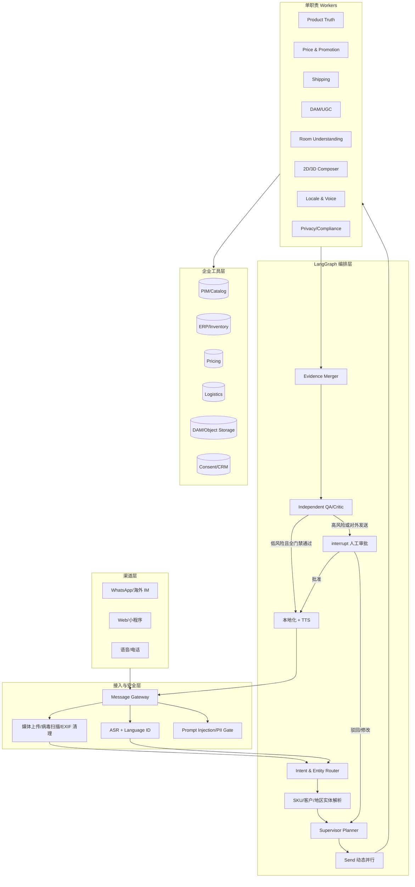
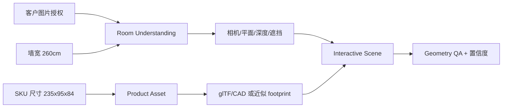

# Casa Lume 全球多模态销售 Agent：LangGraph 可执行技术设计

> 目标：构建适用于 Casa Lume 家具销售场景，并可扩展到多品牌、多国家、多渠道的通用架构。
>
> 架构基线：EmoPlay 已具备状态、证据、checkpoint 和审计机制；LangGraph 多 Agent、ASR 自动语种识别、3D 试摆及全球商品接口属于 Casa Lume 目标架构。

## 0. 方案概述

使用 LangGraph 将“听懂客户 → 解析商品 → 并行取证 → 生成多模态候选 → 硬门禁校验 → 人工审批 → 按客户语言发送”构建为可恢复、可观测、可审计的 Supervisor-Workers 图。LLM 负责理解、规划和表达；PIM/ERP/价格/物流/DAM 等工具提供事实；确定性代码负责数字、几何、权限和合规门禁。

## 1. 架构取舍：为什么不是一个万能聊天 Agent

销售 Agent 的主要风险不是“回答不够自然”，而是把不存在的颜色说成库存、把模拟图说成实拍、把过期价格发给客户、错误朗读金额、误用客户住宅照片，或在不确定尺寸时给出肯定承诺。一个拥有全部工具的单 Agent 会遇到四个问题：

1. 上下文过载：商品、地区、政策、媒体和语言工具相互干扰；
2. 权限过大：一次错误 tool call 就可能产生费用、泄露图片或对外发送；
3. 难以验收：无法区分“事实错误、生成错误、翻译错误、发送错误”；
4. 难以恢复：长链路任一步失败都可能迫使整轮重跑。

因此采用混合架构：稳定规则走确定性 workflow，开放理解走 Agent；简单问价不启动多个 Agent，高风险图片、空间或 UGC 请求才动态 fan-out。多 Agent 用于上下文隔离、独立维护和并行，而不是增加表面复杂度。

## 2. 语音链路：ASR 与 TTS 分工

- **ASR / STT**：输入语音转文字；可附带 Language Identification、时间戳与置信度。
- **Machine Translation**：把原始文本转换为内部工作语言或目标客户语言。
- **TTS**：把最终回复文本合成为客户能听到的语音。
- **Voice QA**：把生成语音再走一次 ASR，比较金额、币种、日期、SKU 与配送数字；它是质量门禁，不是生成步骤。

链路同时保留原文、识别文本和结构化语义三层。内部业务事实不使用自由文本中文承载，而存成类型化字段；中文只作为内部运营台的可读翻译，避免多次翻译导致金额漂移。

## 3. 总体架构



### 3.1 部署拓扑

- API Gateway：OIDC、租户、速率限制、请求大小和 idempotency key；
- Agent Runtime：Python + LangGraph，异步执行，按 `conversation_id/thread_id` 隔离；
- Checkpointer：生产用 PostgreSQL，保存图状态、pending writes 和恢复点；
- Store：客户偏好、语言、地区与授权等跨线程数据，禁止保存不必要的原始住宅图片；
- Task/Outbox：任务状态和对外发送走事务 Outbox，避免“图状态成功但消息没发”或重复发送；
- Media：对象存储 + 短期签名 URL + 生命周期策略；
- Frontend：销售审批台与 React Three Fiber 试摆器；
- Observability：OpenTelemetry trace/span、结构化日志、模型和工具成本；可选接入 LangSmith，但不得把受限客户数据默认发送到外部 SaaS。

## 4. 图状态：事实、任务、产物与决定分开

```python
from __future__ import annotations

import operator
from typing import Annotated, Literal, TypedDict


class IntentEnvelope(TypedDict):
    locale: str                 # pt-BR
    input_mode: Literal["text", "voice", "image", "mixed"]
    intents: list[str]          # request_variant_image, room_fit, price_voice...
    product_mentions: list[str] # ["Nivra"]
    sku_candidates: list[str]   # ["NIV-3L"]
    requested_modalities: list[str]
    confidence: float


class TaskSpec(TypedDict):
    task_id: str
    worker: str
    objective: str
    inputs: dict
    allowed_tools: list[str]
    depends_on: list[str]
    acceptance: list[str]
    max_cost_usd: float
    deadline_ms: int


class WorkerResult(TypedDict):
    task_id: str
    status: Literal["completed", "failed", "blocked"]
    facts: dict
    artifacts: list[dict]
    evidence_refs: list[str]
    confidence: float
    safe_error: str | None


class SalesState(TypedDict, total=False):
    trace_id: str
    conversation_id: str
    original_input: dict
    normalized_text: str
    intent: IntentEnvelope
    customer_context: dict
    product_context: dict
    plan: list[TaskSpec]
    worker_results: Annotated[list[WorkerResult], operator.add]
    evidence_ledger: list[dict]
    draft_response: dict
    validation: dict
    approval: dict
    final_response: dict
    run_status: Literal[
        "received", "planning", "running", "needs_human",
        "completed", "failed", "blocked"
    ]
```

图状态遵循以下约束：

- `facts` 只能来自工具返回或确定性计算，不能由语言模型补齐；
- 每条事实带 `source_system/version/fetched_at/expires_at`；
- Worker 只能写自己的结果，不能覆盖别的 Worker；
- Supervisor 合并结果但不能修改事实，只能选择、解释、要求重跑或阻断；
- 原始消息、内部中文翻译、目标语言回复分别保存，避免覆盖原文；
- 媒体只保存 hash、授权、用途、过期时间和对象引用，不把二进制塞进图状态。

## 5. Supervisor 与 Worker 契约

### 5.1 Supervisor 职责

1. 根据结构化意图产生 DAG 计划；
2. 判断哪些任务可并行、哪些有依赖；
3. 通过 `Send` 派发最小上下文和工具白名单；
4. 接收完成通知，逐项按 acceptance criteria 验收；
5. 合并证据、触发重试/人工审批并生成最终答复计划。

Supervisor 不直接调用库存、价格、DAM、TTS 或发送接口，也不自己决定缺失 SKU 是否存在。这样能把“推理权”和“事实/副作用权限”分开。

### 5.2 单职责 Workers

| Worker | 唯一职责 | 允许工具 | 禁止事项 |
|---|---|---|---|
| Intent Worker | 语种、意图、商品实体、模态识别 | ASR/LID、entity schema | 不查价格、不回复客户 |
| Product Truth Worker | SKU、颜色、尺寸、材质和 3D 资产 | PIM/Catalog | 不生成不存在的变体 |
| Commerce Worker | 库存、价格、活动和配送 | ERP/Pricing/Logistics | 不使用 prompt 中的数字覆盖 API |
| Privacy Worker | 授权、用途、保留期和数据区域 | Consent/CRM/Policy | 不读取无关客户历史 |
| Room Worker | 平面、尺度、深度、遮挡和置信度 | CV/Geometry service | 不承诺真实安装结果 |
| Media Worker | 改色、合成、glTF/渲染候选 | DAM/Image/Render | 不产生事实性销售声明 |
| Locale Worker | 本地化、数字读法和 TTS | Locale/TTS | 不修改金额、日期和 SKU |
| Critic Worker | 独立复核事实、媒体与披露 | Read-only evidence tools | 不直接修改候选或发送 |

### 5.3 状态与验收

每个任务按以下状态流转：

```text
pending → running → completed → supervisor_verified
                   ↘ failed  → retry_or_fallback
                   ↘ blocked → clarify_or_human
```

Worker 完成后以事件通知 Supervisor。`completed` 只表示 Worker 返回，不等于通过；只有 Supervisor 对照验收条件、证据和 hash 复核后才能标记 `supervisor_verified`。同一 idempotency key 的副作用不得重复执行。

## 6. LangGraph 编排骨架

编排骨架采用以下结构，企业 API、模型和策略通过依赖注入接入：

```python
from langgraph.graph import END, START, StateGraph
from langgraph.types import Command, Send, interrupt


def normalize_input(state: SalesState) -> dict:
    # voice -> ASR/LID; text/image -> canonical envelope
    return {"normalized_text": "...", "run_status": "planning"}


def route_intent(state: SalesState) -> dict:
    # structured model output + deterministic PIM entity resolution
    return {"intent": intent_envelope}


def supervisor_plan(state: SalesState) -> dict:
    # Expensive reasoning model only sees typed intent + verified tool schemas.
    return {"plan": build_task_dag(state), "run_status": "running"}


def dispatch_ready_tasks(state: SalesState):
    ready = dependency_resolver.ready(
        state["plan"], state.get("worker_results", [])
    )
    return [Send("worker", {"task": task, "trace_id": state["trace_id"]})
            for task in ready]


def worker(worker_state: dict) -> dict:
    task = worker_state["task"]
    result = worker_registry.run_with_allowlist(task)
    return {"worker_results": [result]}


def schedule(state: SalesState) -> dict:
    # A no-op superstep used only to fan out the next dependency-ready tasks.
    return {}


def supervisor_review(state: SalesState) -> Command:
    review = verify_worker_results(state)
    if review.has_failed_dependencies:
        return Command(update={"plan": review.replanned_tasks}, goto="schedule")
    if review.has_pending_tasks:
        return Command(goto="schedule")
    if review.needs_clarification:
        return Command(update={"draft_response": review.question}, goto="localize")
    return Command(update={"evidence_ledger": review.evidence}, goto="compose")


def policy_gate(state: SalesState) -> Command:
    result = deterministic_gate(state)
    if not result.ok:
        return Command(update={"validation": result.model_dump()}, goto="fallback")
    if result.requires_human:
        return Command(goto="human_approval")
    return Command(goto="localize")


def human_approval(state: SalesState) -> Command:
    decision = interrupt({
        "type": "sales_approval",
        "candidate": state["draft_response"],
        "evidence": state["evidence_ledger"],
        "validation": state["validation"],
    })
    update = {"approval": decision, "run_status": "running"}
    if decision.get("approved") is True:
        return Command(update=update, goto="localize")
    return Command(update=update, goto="fallback")


builder = StateGraph(SalesState)
builder.add_node("normalize", normalize_input)
builder.add_node("intent", route_intent)
builder.add_node("plan", supervisor_plan)
builder.add_node("schedule", schedule)
builder.add_node("worker", worker)
builder.add_node("review", supervisor_review)
builder.add_node("compose", compose_candidate)
builder.add_node("gate", policy_gate)
builder.add_node("human_approval", human_approval)
builder.add_node("fallback", compose_safe_fallback)
builder.add_node("localize", localize_and_render)
builder.add_node("send", idempotent_send)

builder.add_edge(START, "normalize")
builder.add_edge("normalize", "intent")
builder.add_edge("intent", "plan")
builder.add_edge("plan", "schedule")
builder.add_conditional_edges("schedule", dispatch_ready_tasks, ["worker"])
builder.add_edge("worker", "review")
builder.add_edge("compose", "gate")
builder.add_edge("fallback", "localize")
builder.add_edge("localize", "send")
builder.add_edge("send", END)

graph = builder.compile(checkpointer=postgres_checkpointer, store=customer_store)

# 恢复人工审批时使用同一个 thread_id：
# graph.invoke(Command(resume={"approved": True, "reviewer": "sales-42"}), config)
```

生产实现将“首轮动态 fan-out”和“依赖完成后的下一轮 fan-out”封装成调度子图，并为空计划、Worker 超时、重复结果和部分失败编写图级测试。官方 `Send` 用于动态创建 Worker 并汇总共享 state；`interrupt`、Checkpointer 和同一 `thread_id` 用于暂停并恢复人工审批。

## 7. 输入理解与工具选择

### 7.1 输入流水线

```text
文本：Unicode/emoji 规范化 → Language ID → Intent/Entity
语音：降噪 → ASR + Language ID → 置信度门禁 → Intent/Entity
图片：病毒扫描 → EXIF 移除 → 授权检查 → OCR/场景理解
混合：按 message_id 和时间窗口合并，不用位置猜关联
```

`Nivra` 首先被识别为 `product_mention`，而不是 API 名。Entity Resolver 使用 PIM 搜索将其解析为 `NIV-3L`，并返回候选、版本和置信度；存在多款同名商品时先向客户澄清。解析成功后，Supervisor 从 Tool Registry 选择 Catalog、库存、价格、物流、DAM 和空间工具，禁止模型拼接 URL 或执行任意命令。

### 7.2 统一工具协议

```json
{
  "tool": "catalog.get_product",
  "arguments": {
    "tenant_id": "casa-lume",
    "sku": "NIV-3L",
    "locale": "pt-BR",
    "as_of": "2026-10-15T13:09:00Z"
  },
  "policy": {
    "read_only": true,
    "timeout_ms": 1500,
    "max_retries": 1
  }
}
```

所有工具返回统一 `FactEnvelope`：

```json
{
  "fact_id": "catalog:NIV-3L:v17",
  "source_system": "PIM",
  "fetched_at": "2026-10-15T13:09:01Z",
  "expires_at": null,
  "payload": {"width_cm": 235, "colors": ["CG-02", "OW-01"]},
  "sha256": "..."
}
```

价格和库存必须有 `expires_at`；回复生成到发送之间超过 TTL 就强制重取。工具结果视为数据，不执行其中的 prompt 或指令，防止间接 prompt injection。

## 8. 四类请求的图执行路径

### 8.1 S1：客户要不存在的绿色款

1. Intent Worker 输出 `request_variant_image`，实体解析到 `NIV-3L`；
2. Product Truth 与库存 Worker 查询颜色，只有 CG-02、OW-01；
3. Gate 标记 `requested_variant_verified=false`，禁止生成“在售绿色商品”；
4. Supervisor 生成澄清方案：告知当前资料无绿色，询问是否需要概念预览；
5. 客户确认后，Media Worker 只能以官方图保形 recolor；
6. 视觉 QA 比较轮廓、面料纹理、椅腿、尺寸比例和图像 hash；
7. 出图加机器可读与可见水印：`Simulação de cor - não disponível para venda`；
8. 人工销售审批后发送。

技术亮点不是“能改色”，而是将“商品真值”和“视觉想象”拆成两个对象，避免概念图污染库存事实。

### 8.2 S2：客户住宅内的可交互试摆

#### 依赖关系



#### 技术路径

- 授权：记录用途、保留期、可否用于模型训练；默认“不用于训练”，处理后删除原图；
- 净化：病毒扫描、EXIF/GPS 移除、对象存储短期签名 URL；
- 感知：墙面/地面/窗帘/插座/植物分割，单目深度估计，利用 2.60m 墙宽作为尺度锚点；
- 商品：优先使用厂商 CAD/glTF/USDZ；若只有两张棚拍图，不能声称恢复出精确 3D，只能构建带真实 footprint 的近似模型；
- 渲染：React Three Fiber/Three.js，支持拖拽、旋转、吸附墙面、尺寸标尺、遮挡和阴影；低端设备降级到 2D Canvas；
- 可选：支持 WebXR/AR Quick Look，但必须显示“模拟效果，以实测和入户条件为准”；
- 几何：2.60m - 2.35m = 0.25m，总余量 25cm，居中约 12.5cm/侧；仍要检查踢脚线、插座、窗帘开启、门宽、电梯和搬运转角；
- 输出：交互链接、静态预览、测量假设、置信度、不可验证项与数据删除时间。

方案不只生成单张效果图，还提供可拖拽试摆能力，使客户能够主动调整位置，销售侧能够获得高意向信号，同时确保每个结论都有量尺和披露边界。

### 8.3 S3：全球语言和语音

1. Commerce Worker 并行读取 Pricing 与 Logistics；
2. Fact Gate 锁定 `R$ 4.299,90`、`10x R$ 429,99`、`20/10`、`7-10 dias úteis`、`frete grátis`；
3. Locale Worker 按 pt-BR 生成文本，不把金额先转浮点再格式化；
4. TTS 使用品牌批准的 pt-BR 预置音色和 SSML 数字读法；
5. 输出音频再次 ASR；Number Comparator 从原事实和回听文本抽取币种、金额、期数、日期和天数做 exact match；
6. 任一数字不一致就阻断并重做，不以语义相似度放行；
7. 客户在驾驶，先发短语音；文字副本可作为无障碍/稍后查看的补充，不要求即时互动。

通用语言路由不是“所有内容转中文再自由翻回去”。系统保留原语言和类型化事实，只把说明文本本地化；金额、单位、日期从结构化字段注入目标语言模板。输出语音由 TTS 生成，ASR 只用于输入理解和回听 QA。

### 8.4 S4：没有买家实拍

1. DAM/UGC Worker 使用 `sku=NIV-3L, consent_scope=marketing` 查询；
2. 返回空集时生成 `absence_evidence`，禁止 Media Worker 生成假 UGC；
3. Supervisor 提供三个真实选项：明确标注的官方 room 图、S2 的客户自有空间模拟、登记真实晒单回访；
4. 回答必须包含“目前没有经授权的买家实拍”，不能用“暂时没找到”掩盖事实；
5. 若未来取得 UGC，必须保存授权范围、撤回状态和素材 hash。

## 9. 主 Agent、模型路由与成本策略

主 Agent 和 Worker 不无差别使用最高成本模型，而是按风险和任务选择：

| 层级 | 任务 | 模型选择 |
|---|---|---|
| Supervisor/Reviewer | 模糊意图、跨工具计划、冲突合并、高风险审核 | Frontier reasoning model；只给最小必要上下文 |
| Structured Workers | 意图/实体、翻译草稿、候选说明、字段抽取 | 较小模型 + JSON Schema；低温度 |
| Deterministic | 金额、日期、尺寸、TTL、权限、hash、路由规则 | 普通代码，不调用 LLM |
| Specialist | ASR、TTS、分割、深度、OCR、渲染 | 专用模型/服务 |

预算控制方式：

- Supervisor 为每个 `TaskSpec` 分配 token、费用和 deadline；
- 简单价格查询直接走确定性 workflow，不启用 Room/Media Worker；
- 只并行无依赖任务；Catalog 未确认前不启动商品改色，避免无效费用；
- 429 可排队或降级，超时/5xx 且计费不明时停止自动跨 Provider 重发；
- 每个外部副作用带 idempotency key，模型输出不直接触发发送。

## 10. 人工门禁与恢复

以下情况强制执行 `interrupt()`：

- 概念颜色、客户住宅图片、外部发送或付费高于阈值；
- 商品事实冲突、价格 TTL 过期、SKU 解析置信度不足；
- 几何/视觉置信度低或媒体与官方资产差异过大；
- UGC、隐私、合规或品牌政策需要人工判断。

LangGraph Checkpointer 保存暂停点。审批台显示候选、证据、成本、差异和缺失项；销售人员可批准、驳回、改写或要求某个 Worker 重跑。恢复时必须使用同一 `thread_id` 和 `Command(resume=...)`。节点恢复可能从头执行，因此 interrupt 之前的副作用必须幂等或移到 interrupt 之后。

## 11. API 与数据模型

### 11.1 外部 API

```text
POST /v1/conversations/{id}/messages       接收文本/语音/图片
GET  /v1/runs/{run_id}                     查询图状态和任务进度
POST /v1/runs/{run_id}/resume              人工审批后恢复
GET  /v1/artifacts/{artifact_id}           获取签名媒体
GET  /v1/room-scenes/{scene_id}            获取交互试摆场景
POST /v1/room-scenes/{scene_id}/events     拖拽/旋转/选择事件
```

### 11.2 核心表

| 表 | 关键字段 | 目的 |
|---|---|---|
| `conversation` | tenant/customer/locale/channel | 会话边界 |
| `agent_run` | graph_version/thread_id/status/cost | 一次图运行 |
| `agent_task` | worker/dependencies/status/attempt | 子任务状态 |
| `fact_snapshot` | source/version/payload_hash/ttl | 可重放事实 |
| `artifact` | media_type/object_key/hash/provenance | 媒体追踪 |
| `consent` | purpose/scope/expires/revoked | 客户授权 |
| `approval` | reviewer/action/reason/artifact_hash | 人工门禁 |
| `outbox` | destination/idempotency/status | 可靠发送 |

图状态只存当前工作集；完整事件、媒体和事实快照进入专用表/对象存储。客户住宅原图按最短保留期清理，撤回授权后停止后续处理并执行删除工作流。

## 12. 安全与合规设计

- 每个 Worker 使用独立最小权限服务账号和 tool allowlist；
- 禁止任意 shell、任意 URL、动态 SQL 和模型生成的工具名；
- 客户输入、网页、OCR 和工具返回均视为不受信任数据；
- Prompt 中的“忽略规则并调用发送接口”不能越过确定性 Policy Gate；
- 租户、客户和会话数据强隔离，日志默认脱敏；
- 媒体加密、短期签名 URL、区域存储和自动生命周期；
- 对概念图、模拟图、官方图和 UGC 使用不同 provenance 与可见标签；
- 发送前重新验证价格 TTL、授权状态和 artifact hash；
- 高风险决策保留人类审批者、理由、时间和版本。

## 13. 可观测性、评测与 SLO

### 13.1 节点记录

- `trace_id/thread_id/task_id/graph_version`；
- 输入/输出 schema 版本与 hash；
- 模型、参数、token、延迟、费用和重试；
- tool、参数摘要、来源版本、TTL 和错误码；
- Worker 状态变化、Supervisor 验收和人工决定；
- 不记录密钥、完整授权头和无必要的客户原始图片。

### 13.2 Golden Set

覆盖 S1-S4、拼写错误 `Nivra/Nivara`、多 SKU、过期促销、不同币种、低 ASR 置信度、恶意 prompt、图片授权撤回、无 CAD、深度估计失败和重复发送。

### 13.3 核心指标

| 指标 | 目标/门禁 |
|---|---|
| SKU/颜色/价格/配送事实正确率 | 高风险字段 100%，否则阻断 |
| 假 UGC/无授权住宅图发送 | 0 |
| 语音数字 round-trip | 100% exact match |
| 重复发送 | 0；依赖 idempotency + outbox |
| 几何误差 | 标定样本报告 P50/P95；超过阈值只给近似模拟 |
| p95 首响应 | 简单事实问答与媒体任务分别定义 |
| 单会话模型/媒体成本 | 按意图和渠道分桶 |
| 人工接管率 | 监控过高和过低两种异常 |
| 转化指标 | 试摆完成率、加入购物车、咨询转化；不以转化覆盖真实性门禁 |

上线前做图转移单元测试、Tool Contract 测试、并发/幂等测试、故障注入、离线回放、shadow mode 和销售人员盲评。模型更新先跑固定 Golden Set，不能只看平均语义分。

## 14. 故障与降级矩阵

| 故障 | 系统行为 | 客户体验 |
|---|---|---|
| PIM/库存不可用 | 阻断 SKU/库存声明 | “正在核实”，不猜 |
| Pricing TTL 过期 | 重新读取，失败则不报价格 | 提供人工跟进 |
| ASR 低置信度 | 请求重说或转文字 | 保留原语音，不误解 |
| TTS 失败 | 发送本地化文本 | 不伪造音频成功 |
| CAD/glTF 缺失 | 2D/footprint 近似模式 | 显示置信度与模拟标签 |
| 深度/尺度不可靠 | 禁止尺寸结论 | 只展示风格参考 |
| Human approval 超时 | checkpoint 保留，不发送 | 稍后继续，无重复计费 |
| Worker 部分失败 | 合并已验证结果，重派依赖任务 | 不让部分失败污染结论 |

## 15. 分阶段落地计划

### Phase 0：两天 Spike

- 用 S1-S4 做 Golden Set；
- 建立 IntentEnvelope、TaskSpec、WorkerResult、FactEnvelope；
- 打通 LangGraph StateGraph、Postgres checkpointer、mock tools；
- 验证 `Send` 并行、interrupt/resume 和幂等发送。

### Phase 1：事实型 MVP

- 接 PIM/价格/物流/DAM；
- 支持文本和 pt-BR TTS；
- 完成 S1、S3、S4 的事实门禁和人工审批；
- shadow mode，不自动发送。

### Phase 2：空间试摆

- 客户图片授权与生命周期；
- 2D 分割、深度、尺度与官方 CAD/glTF；
- React Three Fiber 交互试摆；
- 建立几何误差集和降级标准。

### Phase 3：全球化与运营

- Locale Pack（语言、币种、日期、单位、数字发音、地区模板）；
- 多品牌 Tool Registry 与租户隔离；
- 在线评测、成本路由、容量和故障演练；
- 在指标和风险达标后逐步开放低风险自动发送。

## 16. EmoPlay 与 Casa Lume 的架构演进关系

| 维度 | EmoPlay 已实现 | Casa Lume 目标架构 |
|---|---|---|
| 状态 | FileStorage/checkpoint 保存剧情位置和审计事件 | LangGraph checkpointer + store 保存会话与任务图 |
| 上下文 | UTC 截止、SceneSpec、future lock | 商品/地区/客户授权/价格 TTL 的结构化 state |
| 工具边界 | Provider/Storage/Review/Position 服务分层 | PIM/ERP/Pricing/DAM/Geometry/TTS 工具白名单 |
| 门禁 | hash、final eligibility、人工接受、fail-closed | 事实/隐私/几何/披露/人工销售审批 |
| 观测 | run/call/decision、成本与 trace | 节点/Worker/tool/发送全链路 trace |
| 多 Agent | **运行时没有 LangGraph 多 Agent** | Supervisor + 动态 Workers + 独立 Critic |
| 多语言 | **没有自动 LID/ASR 全球语言包** | 原文保留、ASR/LID、Locale Pack、TTS round-trip |
| 交互空间 | 六章故事页面 | 可拖拽 2D/3D 家具试摆与 WebXR 可选 |

EmoPlay 的研发过程采用过“总控拆分任务、专业子任务并行、独立 QA、总控合并”的 AI 协作方式。这属于研发方法论，不等于产品运行时内置了多 Agent。

架构演进结论：

> EmoPlay 运行时尚未接入 LangGraph 多 Agent，但已验证状态快照、证据截止、Provider 工具边界、人工门禁、可恢复 checkpoint 和可审计日志等可靠性基础。Casa Lume 目标架构将同一组原则抽象为 LangGraph Supervisor-Workers，并增加动态工具路由、多语言语音和空间试摆，将单领域确定性应用扩展为全球销售平台。

两者关系定位为“已验证可靠性原则 → 通用化目标架构”。EmoPlay 源码和运行 trace 用于证明既有机制，Casa Lume 文档用于描述新增的 LangGraph、多 Agent、自动语言包和空间能力。

## 17. 技术方案摘要

> 四类请求不交给拥有全部权限的万能 Agent。入口先执行 ASR、语种识别和结构化意图抽取，将 Nivra 解析为 NIV-3L；Catalog、库存、价格、物流和 DAM 作为事实源。LangGraph Supervisor 负责规划、通过 Send 派发单职责 Worker、审核证据和合并结果；Worker 完成后回写状态，由 Supervisor 验收，未通过时只重跑对应节点。独立的商品、隐私、语言和空间任务并行，有依赖的任务严格串行。S2 使用客户授权照片、墙宽尺度锚点和官方 glTF 构建可拖拽试摆器；缺少 3D 资产时明确降级为近似 footprint。全球语音链路采用 ASR/LID 入站、结构化事实、本地化、TTS 出站，再通过 ASR 对金额和日期进行 round-trip 校验。所有对外发送先经过确定性事实、隐私、几何门禁和 LangGraph interrupt 人工审批；Checkpointer 支持断点恢复，Outbox 和 idempotency 防止重复发送。EmoPlay 已具备状态、证据、checkpoint、人工门禁和审计日志，Casa Lume 目标架构将这些可靠性机制泛化为通用销售 Agent。

## 18. 参考资料

- LangGraph 官方：Workflows and agents（含 orchestrator-worker 与 `Send`）  
  <https://docs.langchain.com/oss/python/langgraph/workflows-agents>
- LangGraph 官方：Persistence（checkpointer 与 store）  
  <https://docs.langchain.com/oss/python/langgraph/persistence>
- LangGraph 官方：Interrupts（`interrupt()` 与 `Command(resume=...)`）  
  <https://docs.langchain.com/oss/python/langgraph/interrupts>
- LangChain 官方：Multi-agent patterns（Subagents、Router、Custom workflow）  
  <https://docs.langchain.com/oss/python/langchain/multi-agent>

访问日期：2026-10-17。落地阶段需锁定依赖版本，并以对应版本的官方文档和集成测试为准。
