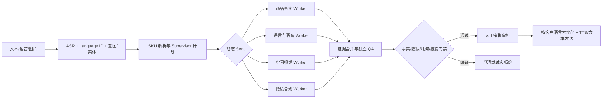

# Casa Lume 全球多模态销售 Agent 技术方案摘要

> 面向多品牌、多国家、多渠道的可落地销售 Agent 架构，覆盖关键接口、质量门禁和实施路径。完整设计见
> [`docs/design/casa_lume_langgraph_sales_agent.md`](../design/casa_lume_langgraph_sales_agent.md)。

方案采用 LangGraph `StateGraph` 构建“确定性门禁 + Agent 路由”的主管-工作者系统。输入先经渠道适配、ASR、语种识别和结构化意图抽取，将 `Nivra` 解析为 SKU `NIV-3L`；Catalog/PIM、库存、价格、物流、DAM 和客户授权服务是唯一事实源。Supervisor 负责规划、用 `Send` 动态派发单职责 Worker、合并证据并审核，不直接编造商品事实；Worker 以 `pending/running/completed/failed/blocked` 回写状态。仅并行无依赖任务，有依赖的任务严格串行。发送或产生费用前通过 `interrupt()` 进入人工审批，Checkpointer 按 `thread_id` 支持恢复与幂等。

- **S1 绿色款**：Catalog 和库存 Worker 先核对颜色。当前只有 CG-02 与 OW-01；未证实绿色 SKU 时禁止生成“在售绿色实物”。客户确认后可生成醒目标注的概念改色图，并锁定结构、面料和椅腿约束。
- **S2 客厅试摆**：商品宽 2.35m、墙宽 2.60m，总余量 25cm，但不据此保证可用。图片处理前取得用途与保留期授权，再进行墙面/地面分割、深度与相机估计；优先加载官方 CAD/glTF，并在 React Three Fiber 试摆器中支持拖拽、旋转、尺度和遮挡。缺 CAD 时只提供“近似模拟”与置信度，不宣称精确安装。
- **S3 葡语语音**：从实时 API 快照读取价格、10 期免息、20/10 截止、7-10 个工作日和免运费，再进行 pt-BR 本地化与 TTS。生成后通过 ASR 回听，并对数字、币种和日期做结构化 diff。ASR 负责语音转文字，TTS 负责输出语音。
- **S4 买家实拍**：DAM/UGC 服务返回“无”时进入拒绝伪造分支，不生成假晒单；替代方案包括明确标注的官方场景图、交互试摆链接或真实晒单回访登记。

EmoPlay 已落地状态、证据、checkpoint、工具边界、人工门禁、fail-closed 和可审计日志，当前运行时仍是确定性单领域服务，未集成 LangGraph 多 Agent、自动语种识别或全球商品 API。Casa Lume 方案将这些已验证原则扩展为通用全球销售编排平台。核心指标包括 SKU/价格事实正确率 100%、高风险越权发送 0、数字语音回听通过率 100%，以及空间尺度误差、p95 延迟、单会话成本、人工接管率和转化提升。
